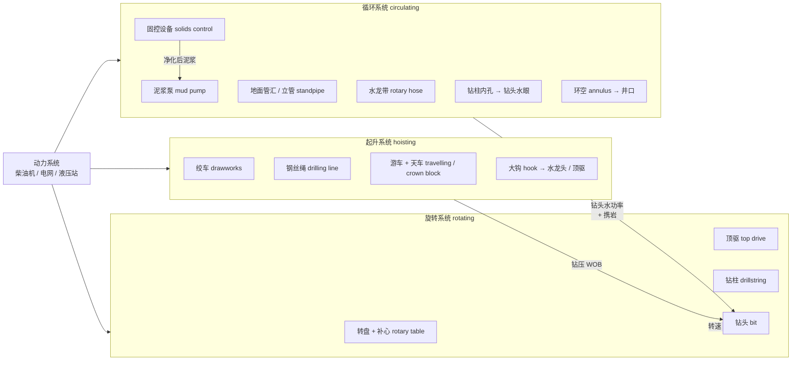

# 01 — Drilling Systems（钻井系统）

## 本章要回答的三个问题

1. 一套钻机由哪几个功能子系统构成，它们之间靠什么传递能量？
2. 每个子系统里最容易失效的是什么部件，失效后果为什么严重？
3. 现场单位（ppg、psi、lbf、ft）与 SI 之间到底差在哪，那些"魔数"是怎么来的？

## 一、把钻机拆成三个功能子系统

钻机不是一堆设备的罗列，而是三条能量链在同一个井口上汇合。任何一台设备的归属，看它把能量送到哪儿就能判断。



三条链在钻头处闭合：**起升系统给钻压，旋转系统给转速，循环系统给水功率并带走岩屑**。这就是"钻井参数"（WOB、RPM、排量）为什么正好是三个——它们各来自一个子系统。

### 1. 起升系统 hoisting

- **功能**：悬持钻柱重量、下放钻具给钻压、起下钻作业。
- **能量链**：柴油机 → 绞车滚筒 → 钢丝绳（游动系统）→ 大钩。
- **关键量**：大钩载荷（hook load）与游动系统绳数决定快绳拉力；名义钻深与最大钩载是钻机的两个规格上限。
- **失效模式**：钢丝绳疲劳断丝、刹车（盘刹/带刹）热衰退、天车与游车碰撞（上碰下砸）。起升系统的失效后果是**落物**，属于最严重的一类。

### 2. 旋转系统 rotating

- **功能**：把扭矩传给钻头，并承受反扭矩。
- **能量链**：转盘（或顶驱）→ 方钻杆/顶驱主轴 → 钻柱 → 钻头。
- **关键量**：转速、扭矩、钻柱的弯曲与疲劳。
- **失效模式**：钻杆接头螺纹疲劳断裂、顶驱齿轮箱或液压系统故障、转盘补心未坐牢导致钻具落井。现代钻机基本用顶驱替代转盘，理由是**接单根时仍能循环和旋转**，这是控压和防卡的关键能力。

### 3. 循环系统 circulating

- **功能**：输送泥浆、传递水功率、携岩、平衡地层压力、冷却钻头。
- **能量链**：泥浆泵 → 地面管汇 → 水龙带 → 钻柱内孔 → 钻头水眼 → 环空 → 固控 → 回罐。
- **关键量**：排量、泵压、环空返速、当量循环密度（ECD）。
- **失效模式**：泵阀与缸套刺漏、水龙带爆裂、固控失效导致固相累积（泥浆性能恶化 → 摩阻上升 → 卡钻）。循环系统是**唯一同时在"力学"和"井控"两个维度上都关键**的子系统：泵一停，ECD 立刻下降，井底压力随之变化。

## 二、单位与量纲：两个"魔数"的来历

钻井工程的现场单位是一套历史遗留的混合制。理解它的正确方式不是背系数，而是**从 SI 第一性原理推一遍**，你会发现所有系数都只是纯单位换算，没有一丝物理。

### 2.1 常用换算

| 量 | 现场单位 | SI | 换算因子 |
|---|---|---|---|
| 密度 | ppg（lbm/gal） | kg/m³ | × 119.8264 |
| 压力 | psi | Pa | × 6894.757 |
| 力 | lbf | N | × 4.448222 |
| 长度 | ft | m | × 0.3048 |
| 体积 | gal（US） | m³ | × 0.003785412 |
| 当量密度 | g/cc | kg/m³ | × 1000 |
| 压力梯度 | psi/ft | Pa/m | × 22620.6 |

### 2.2 `0.05195` = 12/231

静液柱压力从 SI 出发就是 $p = \rho g z$，没有任何系数。换成现场单位：

- $\rho = \rho_{ppg}$ lbm/gal，而 1 gal = 231 in³，所以 $\rho[\mathrm{lbm/in^3}] = \rho_{ppg}/231$；
- $z = z_{ft}$ ft，而 1 ft = 12 in，所以 $z[\mathrm{in}] = 12\,z_{ft}$；
- 英制里重力加速度恰好写成 $g = 1.0\ \mathrm{lbf/lbm}$。

代入：

$$
p[\mathrm{psi}] = \frac{\rho_{ppg}}{231} \times 1.0 \times 12\,z_{ft} = \underbrace{\frac{12}{231}}_{0.051948}\ \rho_{ppg}\, z_{ft}
$$

所以 **0.05195 就是"12 英寸每英尺 ÷ 231 立方英寸每加仑"**。它跟地层、跟泥浆、跟钻井都没有关系——它是美国人用加仑量泥浆留下的化石。

### 2.3 `0.00981` = g/1000

国内现场常用"当量密度 g/cc × 深度 m → 压力 MPa"，系数是 0.00981。同样从 SI 出发：

$$
1\ \frac{\mathrm{g}}{\mathrm{cm^3}} \times 9.80665\ \frac{\mathrm{m}}{\mathrm{s^2}} \times 1\ \mathrm{m} = 9806.65\ \mathrm{Pa} = 0.00980665\ \mathrm{MPa}
$$

即 **0.00981 = 9806.65 / 10⁶**，其中唯一的物理量只有 $g$。

### 2.4 代码约定

计算内部一律 SI（Pa、m、kg/m³），现场单位只出现在 `drilleng.py` 的换算函数里。这样做的收益在验证算例时才显现：当结果和书上对不上时，可以确定是公式错了，而不是单位串了。

`drilleng.py` 里对应的两个函数：

```python
>>> import drilleng as de
>>> de.field_hydrostatic_coefficient()   # 0.05194805194805195
>>> de.mpa_per_gcc_m()                   # 0.00980665
```

## 三、自测

1. 顶驱相比转盘多解决了什么问题？为什么这个问题在控压钻井里是致命的？
2. 如果泥浆泵突然停泵，井底压力会朝哪个方向变化？谁受影响最大？
3. 一台钻机标称最大钩载 4500 kN，用 6×7 游动系统（12 股绳），快绳最大拉力是多少？为什么实际取值要打折？
4. 把 1.35 g/cc 的当量密度换算成 ppg，再算 3000 m 垂深处的静液压力（MPa）。
