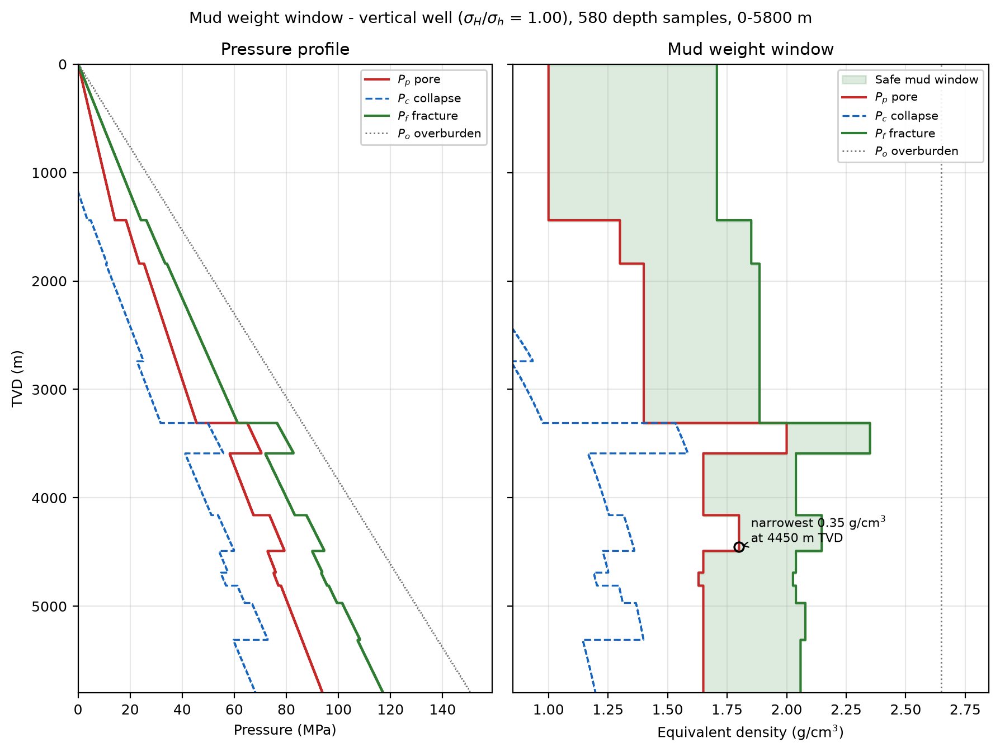

# Fundamentals of Drilling Engineering — calculation notes

A personal, reproducible workbook for drilling engineering: derivations written from scratch,
checked against closed-form solutions, and implemented as runnable code.

Studying *Fundamentals of Drilling Engineering* (Mitchell & Miska, SPE, 2011) one topic at a time.

[](https://molab.marimo.io/github/cospeng/fundamentals-of-drilling-engineering/blob/main/02-rock-mechanics.py/wasm)



## What this is

- 每一章 = **一段自己写的推导 + 一份可重算的代码 + 一张成品图 + 一段工程判断**。
- 单位统一 SI（Pa、m、kg/m³），现场单位只出现在 `drilleng.py` 的换算函数里。
- 代码是 marimo notebook（纯 `.py`），改一个参数，整条链条自动重算。

## What this is not

- 不是教材的复刻或搬运：正文只包含自己的推导与复述，不含原文、原图、原题。
- 不是施工设计依据：数据是**示例设计取值，非实测**，参数未经过岩心或测井标定。
- 不包含任何井位信息（井号、坐标、海拔、完井深度）。

## Contents

| # | Topic | File | Interactive |
|---|---|---|---|
| 01 | 钻井系统（三大子系统、单位与两个"魔数"的来源） | [01-drilling-systems.md](01-drilling-systems.md) | — |
| 02 | 岩石力学与泥浆密度窗口（三压力 → 安全密度窗口） | [02-rock-mechanics.py](02-rock-mechanics.py) | [run in browser](https://molab.marimo.io/github/cospeng/fundamentals-of-drilling-engineering/blob/main/02-rock-mechanics.py/wasm) |

## Run it

```bash
uv run drilleng.py                                 # physics self-test (8 checks)
uvx marimo edit 02-rock-mechanics.py               # open the notebook locally
uvx marimo export session --sandbox 02-rock-mechanics.py   # refresh the GitHub preview snapshot
```

No virtualenv to create: every notebook declares its own dependencies inline (PEP 723) and
`uv` resolves them on the fly.

## Chapter 2 in one paragraph

由密度剖面积分得到上覆压力，由压力系数给出孔隙压力，用单轴应变关系估计最小水平主应力，
再用 Kirsch 解分别求拉伸破坏（破裂压力）与 Mohr-Coulomb 剪切破坏（坍塌压力），
两者与孔隙压力组合成泥浆密度窗口。示例层序下窗口宽度 0.35–0.71 g/cc，
最窄处 0.347 g/cc 落在 4450 m 的高压层——**异常高压必然压缩钻井窗口，因为水平应力的
增幅只有孔隙压力的 ν/(1−ν) ≈ 0.41 倍**。把水平应力各向异性从 1.0 拉到 1.3，
最窄点会跳到 3590 m 并收窄到 0.155 g/cc，说明这个模型最敏感的输入是构造应力，
不是岩石强度。

## Repository layout

```
drilleng.py                 SI-first helper functions + self-test
01-drilling-systems.md      descriptive chapter, no code
02-rock-mechanics.py        marimo notebook (single source, PEP 723 deps)
data/formation_layers.csv   cleaned example layer table (no well identifiers)
figures/                    figures produced by the notebooks
__marimo__/session/         rendered outputs, committed so GitHub can preview them
AGENTS.md                   the rules this repo is built under
```

## Licence

Code: MIT. Text and figures: CC BY-NC 4.0. See [LICENSE](LICENSE).
